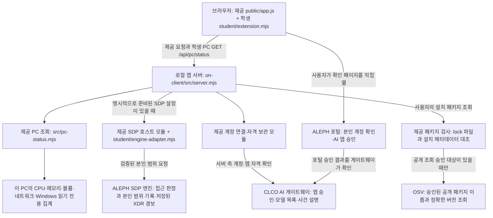

# 케셰브 학생용 실행 설명서와 시스템 구성도

처음 실행하는 사람은 **2장 준비 → 3장 실제 폴더 찾기 → 4장 실행·화면 확인 → 5장 중지·재실행** 순서로 따라갑니다. 다른 PC에서는 작성자의 드라이브 경로를 복사하지 않고 본인이 받은 프로젝트의 on-client 폴더에서 시작합니다. 관리자 권한과 포장 명령은 사용하지 않습니다.

현재 안내의 코드 대조 기준은 235b905ced91685829106261c8c917e33ef84305(학생 관제 화면과 조회 조작 정리), 안내 갱신일은 2026-10-29입니다. 시작 틀은 0.2.21입니다. 이 문서는 원래 2026-10-28의 21단계에서 작성했으며 당시 코드 대조 기준은 a71210cb3b002b9f9060f3c895f2f067ab3afd14였습니다. 이전 제출 커밋·누적 작업은 보존합니다. 이번 수정은 실행 설명서 한 파일뿐입니다.

**이번 제3자의 실제 실패 단계·오류 문구는 제공되지 않았습니다.** 코드 오류나 특정 원인을 확정하지 않았고, 복사하기 쉬운 작성자 전용 경로·과거 안내와 현재 버튼의 혼동을 줄였습니다. 이 안내를 제3자가 처음부터 끝까지 따라 실행했다는 결과는 아직 미확인입니다.

## 1. 목적과 구분할 상태

케셰브는 본인의 PC 상태를 조회하고, 준비된 원천 연결이 있을 때 본인의 로그인·기기·현재 세션·업무 앱 판정·접속/XDR 기록을 확인하는 로컬 앱입니다. 현재 학생 관제의 핵심 세 기능은 **내 PC 상태, 실측 추이·비교, 이 앱의 조회 기록**입니다. 위쪽 상태 카드 네 개 아래에 추이·비교·기록을 두며, 긴 PC 상세와 기존 기기·알림·진단은 펼쳐 볼 수 있습니다. 별도의 실행 프로그램이나 포장본을 만들지 않고 프로젝트 폴더에서 실행합니다.

| 화면·상태 | 뜻과 다음 행동 |
| --- | --- |
| PC 실측 응답·조회 완료 시각 | 이 앱을 실행한 PC에서 읽은 값입니다. 인터넷·SDP 연결·안전 인증이 아닙니다. |
| 확인 불가 | 미조회·실패·권한 부족·지원 없음·오래됨 등의 이유를 읽습니다. 0이나 정상, 예시 값으로 대신하지 않습니다. |
| SDP 미연결 / ENGINE_NOT_CONNECTED | 원천 기기·세션 조회가 연결되지 않은 상태입니다. PC 조회 성공과 별개입니다. 설정을 임의 생성하거나 인증 정보를 옮기지 않습니다. |
| 예제 자료 / demo | 제공 예제 사용자·업무 앱·사건입니다. 실제 원천 계정·접근 판정·보안 경보가 아닙니다. |
| 설명용 예시 보기 | 학생 관제에서 사용자가 켠 고정 설명용 값입니다. 실측 카드·추이·비교·조회 기록에 넣지 않습니다. |
| AI 모델 목록 verified | 과거 해당 시각의 계정·앱 권한과 모델 응답 확인입니다. 현재 연결·사건 설명·보안 조치 성공을 대신하지 않습니다. |

원천 자료·판정 엔진과 실제 사건 설명·조치 집행·OSV 조회는 기존 기록에서 미연결·미실행입니다. 다른 사람이 앱을 시작했다고 이 연결들이 자동으로 준비되는 것은 아닙니다. Windows 경고·오류 건수는 침해나 공격 탐지 결과가 아니며 방화벽 켜짐도 전체 보안 판정이 아닙니다.

## 2. 필요한 프로그램과 버전

이 문서는 Windows에서 일반 사용자 권한으로 실행하는 절차입니다. 관리자 PowerShell을 열지 않습니다. 이미 프로그램이 있으면 재설치하지 않고 버전부터 확인합니다. 설치가 필요한 경우 제공 [시작 안내](STUDENT_LAUNCH_GUIDE.md)를 따릅니다. 회사·학원 PC의 설치 제한은 이 절차로 우회하지 않습니다.

| 항목 | 현재 코드의 기준 | 작성자 PC에서 확인한 범위 |
| --- | --- | --- |
| Windows | 제공 Windows 실행 도구 사용 | Windows 실행 확인. 다른 OS 실행은 미확인 |
| Node.js | package.json 기준 24.19.0. 제공 런처가 허용하는 주 버전은 22~24 | v22.18.0에서 기존 실행·문법 검사 확인. 모든 세부 버전을 시험하지 않음 |
| Windows PowerShell | 명령의 powershell 사용 | 5.1.26100.9711 확인. 별도 개발 셸 7.6.5와 구분 |
| 브라우저 | 로컬 HTTP·DOM·기본 키보드 조작 지원 | Chrome 사용자 화면 확인. 정확한 브라우저 버전·다른 브라우저는 미확인 |
| Git | 저장소를 받거나 커밋·원문을 확인할 때 사용 | 2.40.0.windows.1 확인. 이미 받은 폴더에서 앱을 켜는 명령과 별개 |

on-client/package.json에는 외부 dependencies/devDependencies가 없고 on-client/package-lock.json도 없습니다. 이 앱을 켜기 위해 npm install을 하거나 lock·패키지 파일을 새로 만들 필요가 없습니다. 루트의 package.json·package-lock.json은 이전 1~12단계 자료실용이므로 구분합니다. 기존 루트 의존성을 삭제하거나 바꾸지 않습니다.

Node 기준 버전 참고 문구와 SQLite ExperimentalWarning만으로 실행 실패라고 판단하지 않습니다. 실제 실패는 종료·오류 문구·브라우저 응답과 함께 확인합니다. 프로그램·의존성 설치와 Node 버전 변경은 이번 문서 수정에서 실행하지 않았습니다.

## 3. 실제 앱 폴더를 찾고 PowerShell 열기

1. 파일 탐색기에서 본인이 받은 프로젝트 폴더를 엽니다. 기존 프로젝트와 제출물을 옮기거나 새 시작 틀로 덮어쓰지 않습니다. ZIP 안에서 실행하지 말고 이미 압축을 푼 프로젝트를 사용합니다.
2. 그 안의 **on-client** 폴더로 들어갑니다. package.json과 student·src·tools 폴더가 함께 보여야 합니다. 루트에도 package.json이 있으므로 파일 이름 하나만으로 판단하지 않습니다.
3. 이 탐색기 창의 주소 표시줄을 클릭하고 **powershell**을 입력한 뒤 Enter를 누릅니다. on-client 위치에서 일반 PowerShell 창이 열립니다. 다른 위치에서 연 창이라면 다시 탐색기에서 이 순서로 여는 것이 가장 쉽습니다.
4. 아래 위치·파일 확인 명령을 실행합니다. Test-Path 결과 세 개가 모두 True여야 4장으로 진행합니다. False가 있으면 9장의 파일·폴더 오류를 확인하고 멈춥니다.

```powershell
Get-Location
Test-Path -LiteralPath .\package.json -PathType Leaf
Test-Path -LiteralPath .\student\extension.mjs -PathType Leaf
Test-Path -LiteralPath .\tools\start-alekov.ps1 -PathType Leaf
```

작성자의 기존 앱 위치는 D:\ALEPH_choi-bujang-secret-vault\on-client였습니다. 이것은 작성자 환경 기록이며 다른 PC에 입력할 명령이 아닙니다. 127.0.0.1 주소 역시 지금 실행한 본인 PC를 뜻합니다.

```text
본인이 받은 프로젝트/               Git 최상위·기존 자료실 보존
├─ README.md                       누적 작업 기록
├─ package.json / package-lock.json 이전 1~12단계 자료실
├─ aleph.config.json               기존 자료실 설정(step 12)
├─ api/ · src/ · xdr/               기존 자료실·판정·탐지 작업
└─ on-client/                      이 앱을 실행할 위치
   ├─ package.json                 시작 틀 0.2.21, start/demo/check/package-app
   ├─ student/extension.mjs        학생 함수 8개와 PC 관제 표시·조회 조작
   ├─ student/appearance.json      선택 사항. 케셰브 이름·student-first 배치
   ├─ student/engine-adapter.mjs   제공 원천 연결 어댑터
   ├─ public/app.js · style.css    제공 화면·메뉴·스타일
   ├─ public/pc-status-view.mjs    제공 PC 화면(이전 승인 표시 변경 포함)
   ├─ src/server.mjs              제공 로컬 서버
   ├─ src/pc-status.mjs           제공 PC 조회(이전 승인 다중 드라이브 확장 포함)
   ├─ src/engine/ · connection/ · ai/ · actions/ · vulnerabilities/
   ├─ .env.example                비밀 없는 제공 설정 견본
   ├─ tools/start-alekov.ps1       제공 Windows 실행 도구
   └─ docs/STUDENT_RUNBOOK.md      이 안내
```

제공 실행 파일 이름의 alekov는 그대로 사용합니다. 앱 표시 이름 케셰브가 파일명을 자동 변경하지 않습니다. 같은 저장소의 Vercel 자료실·기존 판정기와 로컬 앱이 자동 통합되지는 않습니다. 앱을 켜려고 aleph.config.json의 단계를 바꾸거나 루트의 npm run bundle·포장 명령을 실행하지 않습니다.

## 4. 처음 실행하고 화면 확인하기

### 4-1. 버전과 학생 코드 문법 확인

3장에서 연 on-client PowerShell 창에서 한 줄씩 실행합니다.

```powershell
node --version
npm.cmd run check
```

node가 없거나 버전이 런처 허용 범위 밖이면 9장의 해당 오류를 먼저 확인합니다. npm.cmd run check는 학생 코드 문법 검사뿐이며 인증·인가·실제 연결 성공을 뜻하지 않습니다. 같은 문법 검사를 node --check .\student\extension.mjs로 할 수도 있고, 오류가 없으면 출력 없이 끝납니다. 오류가 있으면 그 첫 오류를 기록하고 앱 실행 전에 멈춥니다.

### 4-2. 일반 권한으로 앱 실행

```powershell
powershell -NoProfile -ExecutionPolicy Bypass -File .\tools\start-alekov.ps1
```

이 명령은 기존 제공 실행 도구입니다. ExecutionPolicy Bypass는 호출한 PowerShell 프로세스 범위이며 전역 실행 정책을 바꾸지 않습니다. 관리자 권한을 요구하지 않습니다. 실행 도구가 폴더·버전·포트를 확인하고 앱을 켭니다. 기본 실행에서는 프로젝트 밖 본인 Windows 사용자 폴더의 계정 연결용 개인 설정을 준비하거나 기존 설정을 검증합니다. 이것은 로그인·AI 앱 승인·SDP 연결 완료가 아닙니다. 다른 사람의 설정·인증 파일을 복사하지 않습니다. .env.example은 견본이며 키·토큰을 넣어 제출하지 않습니다.

기본 포트에서 정상 시작 시 다음 문구가 나옵니다. 주소·포트는 실제 출력값을 사용합니다.

```text
케셰브가 켜졌습니다. 브라우저에서 http://127.0.0.1:5189/ 을 여세요.
서버가 응답한 것만 확인했습니다. AI 연결 상태는 화면에서 따로 확인해 주세요.
끄려면 이 창에서 Ctrl+C 를 누르세요.
```

**앱을 쓰는 동안 이 PowerShell 창을 열어 둡니다.** 참고 버전·SQLite 경고만 보인 뒤 위 시작 문구가 나왔다면 경고만으로 실패로 보지 않습니다. 포트 사용 중이나 준비 실패로 종료되면 9장으로 이동합니다. 연결 준비 문구 하나만으로 서버 시작까지 완료됐다고 판단하지 않습니다.

### 4-3. 기본 화면과 첫 PC 조회

1. 브라우저에서 [기본 로컬 앱](http://127.0.0.1:5189/)을 엽니다. 별도 포트를 사용했다면 5장의 해당 주소를 엽니다.
2. 보호 현황·업무 앱·보안 기록 세 메뉴가 보이는지 확인하고 **보호 현황 → 학생 상태·알림 표시 → 케셰브 · 내 PC 관제**를 찾습니다.
3. 핵심 기능 바로가기 **1. 내 PC 상태 / 2. 실측 추이·비교 / 3. 조회 기록**과 상태 카드 네 개를 확인합니다. 미조회 상태를 실측이나 예시 값으로 채우지 않습니다.
4. 학생 영역의 **다시 조회**를 누릅니다. **조회 중…**을 거쳐 새 실측 시각·값 또는 실패 항목·이유·다음 행동이 나오는지 봅니다. 같은 요청이 진행 중이면 추가 요청을 보내지 않습니다.
5. **PC 상세 · 네트워크·방화벽·Windows 기록·SDP**를 펼칩니다. 네트워크는 구성 개수, 방화벽은 프로필별 읽은 설정이며 Windows 경고·오류는 최근 24시간 System·Application 합산입니다. 읽지 못하면 확인 불가로 두고 권한을 높이지 않습니다. **SDP 미연결**은 PC 조회 성공과 따로 봅니다.
6. 필요하면 잠시 뒤 다시 조회를 한 번 더 눌러 추이와 직전 비교를 확인합니다. 현재 페이지에서 받은 표본만 사용하며 첫 표본은 이전 값이 없어 비교할 수 없습니다. 60초가 지나면 현재 값은 확인 불가로 바뀌며 직접 다시 조회합니다. 과거 표본·기록은 날짜가 있는 이력으로 남습니다.

학생 **다시 조회**는 PC 값, 제공 상단의 **다시 불러오기**는 계정·앱·기록 등 원천 자료, **도움정보 불러오기**는 진단을 확인하는 서로 다른 버튼입니다. 제공 **내 PC 확인**도 별도 조회 상태를 사용하므로 두 PC 영역의 조회 시각과 값이 같을 필요는 없습니다. 자동 PC 조회는 기본 꺼짐이며 켜고 싶을 때 한쪽 영역에서만 선택합니다. 연결되지 않은 엔진·AI·OSV 기능을 확인하려고 계정 승인이나 실제 조치·유료 요청을 누를 필요는 없습니다.

### 4-4. 키보드와 실측·예시 구분

- Tab·Shift+Tab으로 이동합니다. 버튼은 Enter 또는 Space, 체크박스는 Space, 펼침은 Enter 또는 Space로 조작합니다. 기능 바로가기 링크는 Enter로 해당 제목으로 이동하며 필터는 기본 선택 상자 키보드 조작을 사용합니다.
- 실측에는 서버 조회 완료 시각과 %·GiB·개·건 등의 단위가 표시됩니다. 값별 독립 측정 시각은 제공되지 않습니다. Windows 기록을 못 읽었다고 0건·이상 없음으로 바꾸지 않습니다. SDP 확인 시각을 PC 시각으로 대신하지 않습니다.
- 학생 **설명용 예시 보기**는 사용자가 켠 별도 고정 값 영역이며 측정 시각이 없습니다. 실측 카드·추이·비교·조회 기록에 합치지 않습니다. 실패한 실측을 대신하는 값이 아닙니다.
- 기존 개인 자격과 실제 시스템이 준비되지 않은 상태, 과거의 예제·사용자 보고, 지금의 PC 실측은 각각 구분합니다. 전체 앱이 안전하거나 운영 연결이 끝났다고 적지 않습니다.

## 5. 중지·재실행·포트 충돌·새 코드 읽기

| 하려는 일 | 따라 할 순서 | 결과를 구분하는 기준 |
| --- | --- | --- |
| 중지 | 앱을 실행한 해당 PowerShell 창에서 Ctrl+C | 그 앱을 중지하는 동작입니다. 모든 node 프로세스를 종료하거나 파일을 삭제하지 않습니다. 계속 포트 사용 중이면 기존 실행 창과 주소를 먼저 확인합니다. |
| 재실행 | 같은 on-client 폴더에서 4-2의 명령 재실행 | 시작 문구와 실제 출력 주소를 확인합니다. 열린 브라우저에서 학생 다시 조회를 직접 눌러 새 PC 값을 확인합니다. 원천 자료는 제공 다시 불러오기로 별도 확인합니다. |
| 학생 화면 파일 변경 | 서버가 켜져 있을 때 브라우저 Ctrl+F5 | 최신 student/extension.mjs를 읽습니다. 현재 페이지의 실측 표본·조회 기록은 새로고침 시 초기화됩니다. |
| 서버 파일 변경 | 본인 앱을 해당 창에서 중지 후 재실행 | 브라우저 새로고침만으로 서버 코드가 바뀌지는 않습니다. 이번 문서 수정에는 서버 변경이 없습니다. |
| 실패 후 복구 확인 | 브라우저는 연 채 본인 서버 중지 → 학생 다시 조회 → 같은 명령으로 재실행 → 학생 다시 조회 | 실패 화면과 새 응답을 구분합니다. 전체 브라우저 새로고침으로 서버 중지 시험을 대신하지 않습니다. 과거 실패 기록은 이력으로 남을 수 있습니다. |

기본 포트 5189를 사용 중이라는 메시지는 새 실행을 멈춘 것이며, 실행 중인 다른 프로그램을 끄라는 뜻이 아닙니다. 본인의 기존 앱이 정상이라면 그 화면을 사용합니다. 별도 실행이 필요한 경우에만 on-client 창에서 다음처럼 다른 포트를 선택합니다.

```powershell
powershell -NoProfile -ExecutionPolicy Bypass -File .\tools\start-alekov.ps1 -Port 5190
```

이때 브라우저도 [5190 로컬 앱](http://127.0.0.1:5190/)을 열어야 합니다. 5190도 사용 중이면 실행 도구가 알려 주는 다른 번호를 사용하고 그 번호의 주소를 엽니다. 기존 앱·다른 사람의 프로그램을 일괄 종료하지 않습니다. 계정·AI 승인·원천 연결은 실행 상태별로 별도 확인하며 설정을 임의 변경하지 않습니다.

제공 예제 화면이 필요할 때만 별도 포트에서 다음을 사용합니다. 기본 PC 확인에 필요한 명령은 아닙니다.

```powershell
powershell -NoProfile -ExecutionPolicy Bypass -File .\tools\start-alekov.ps1 -Demo -Port 5190
```

-Demo의 사용자·앱 판정·사건은 예제이며 실제 SDP 연결이 아닙니다. PC 조회 버튼의 source=local-pc 실측과도 구분합니다. -Demo는 계정 연결 개인 설정을 자동 준비하지 않습니다. 돌아갈 때는 그 실행 창에서 중지하고 옵션 없는 4-2 명령으로 실행합니다. 이 안내는 창이 보이는 실행만 사용하며 -Background·설치형 포장·내보내기 명령은 실행하지 않습니다.

## 6. 시스템 구성도와 출처



이 구성도는 현재 파일의 역할과 조건부 연결 경로를 설명합니다. 원천 엔진과 OSV의 실제 연결 성공을 뜻하지 않습니다. 기존 여덟 학생 렌더러는 제공 화면이 넘긴 원천 상태·자료로 DOM을 만듭니다. 후속 학생 PC 관제는 createStudentView({api,onChange})의 제공 API 객체로 GET /api/pc/status 한 경로만 직접 조회합니다. OS 측정은 제공 src/pc-status.mjs를 재사용하며 학생 코드에 새 수집기를 만들지 않았습니다. 학생 코드는 AI 호출·원천 자료 API·조치 집행 요청을 추가하지 않습니다. 제공 public/app.js는 기존 요청·응답 검증·취소·세대 비교와 학생 화면 갱신을 담당합니다.

| 경로·주소 | 역할·출처 | 현재 확인 |
| --- | --- | --- |
| `on-client/public/app.js` → `on-client/src/server.mjs` | 제공 코드의 같은 출처 로컬 API. 토큰을 학생 렌더러에 넘기지 않음 | 로컬 화면과 오류 표시 확인 |
| `on-client/src/engine/sdp-host.mjs` → ALEPH SDP 엔진 | 제공 엔진의 본인 범위 접속·기록 계약. 실제 주소·개인 자격은 프로젝트 밖의 담당자 제공 설정 | 원천 엔진 미연결. 임의 relay 주소·인증서를 만들지 않음 |
| `on-client/src/connection/`·`on-client/src/ai/` → [CLCO 게이트웨이](https://ai-classroom-gateway-production.up.railway.app) | 제공 모듈이 처리하는 계정·앱 승인·서버 측 AI 연결 | 계정·앱 승인, 모델 목록 `verified`·1개를 사용자 화면에서 확인 |
| 브라우저 → [ALEPH 포털](https://aleph-omega.vercel.app) | 사용자가 본인 계정 확인과 AI 앱 승인을 수행 | 사용자 보고로 확인. 일회성 확인 URL·번호는 기록하지 않음 |
| `on-client/src/vulnerabilities/project-scan.mjs`·`osv.mjs` → [OSV 공개 조회](https://api.osv.dev/v1/querybatch) | 제공 검사기가 승인된 공개 패키지와 설치 버전을 대조하여 조회 | 프로젝트 미설정이므로 실제 OSV 조회는 미실행 |
| 학생 PC 관제 → GET /api/pc/status → src/pc-status.mjs | 제공 측정을 재사용한 학생 카드·추이·비교·조회 기록. 고정 로컬 볼륨별 수집과 제공 PC 표시 파일은 이전에 승인한 후속 확장 포함 | 사용자 PC 실측 보고. Windows 기록 건수는 읽지 못해 미확인 |
| 루트 `src/decider.mjs`·`src/detect.mjs`·`xdr/` | 이전 단계의 학생 판정·탐지·가상 경보 모듈 | Git에 보존. 로컬 앱 시작만으로 이 모듈이나 기존 Vercel 자료실이 자동 연결되지는 않음 |

접근 제어 엔진의 출처는 **ALEPH SDP 엔진**입니다. 학생의 판정 규칙·XDR 가상 경보 작업과 13~20단계 학생 UI는 그 제공 엔진 전체를 새로 구현한 것으로 표시하지 않습니다. Workbench 수업용 AI는 개발 지원, 앱 내부 AI는 사건 해석, ALEPH 공식 과제 AI는 제출 원문 검토 역할입니다. 이 세 역할을 구분합니다.

## 7. 학생 구현 함수와 입력 계약

여덟 함수는 모두 `on-client/student/extension.mjs`의 `createStudentView`가 반환합니다. 제공 화면이 상태·자료를 전달하고, 학생 함수는 새 DOM을 반환합니다. `idle/loading/ok/error` 등의 조회 상태와 자료 안의 업무 판정·실행 상태는 별개입니다.

| 단계·학생 함수 | 받는 값 | 구현한 표시와 한계 |
| --- | --- | --- |
| 13 `renderIdentity` | `{me,devices,sessions}` 각각 `{status,mode,data?,error?}` | 사용자·기기·세션의 ID/이름, 기기·세션 상태의 한국어와 원래 코드, 오류 시 이전 정보 제거 |
| 14 `renderDecision` | `{status,mode,data?,error?,appId}`, data는 `{appId,decision,reason,checkedAt}` | allow·deny·challenge·unknown와 요청 실패 구분. 허용은 실제 앱 접속 성공을 보장하지 않음 |
| 15 `renderEvents` | `{status,mode,data?,error?}`, data는 본인 기록 배열 | 최신순, 종류·앱·접속 상태 필터, 근거·규칙·세 상태 상세. 서버 조회 범위는 최근 40건이며 학생 함수에 전체 메타데이터는 전달되지 않음 |
| 16 `renderStatus` | `{devices,sessions,notifications,diagnostics,mode}` | 빈 목록·실패·수동 재조회 안내, 알림별 resource/code/message, 안전한 진단 6항목과 클릭 시 복사. 후속 학생 PC 관제의 세 기능·다시 조회·대기·실패 안내·PC/SDP 분리도 함께 표시. 미지원 조치는 renderEvents 상세의 비활성 안내 |
| 17 `renderAiConnection` | `{status,mode,data?,error?,checkedAt,explanationAccepted}` | test·verified, 모델 수·시각, 안전한 오류 원인과 직접 재점검 안내. 모델 목록을 사건 설명 성공으로 계산하지 않음 |
| 18 `renderExplanation` | `{event,explanation,checkedAt}` | 현재 사건의 근거 ID와 문장·규칙·unknown·제안 미실행을 대조. 없는 근거·실행됐다는 응답에 성공 표식 없음 |
| 19 `renderAction` | `{status,event,actionId,target,receipt,observation,message,confirmationExpiresAt?,error?}` | 사람 확인 전 준비·미실행, 전송·ACK·효과 관측 구분. succeeded와 effectApplied:true인 경우만 효과 확인. 버튼·티켓·집행 요청을 추가하지 않음 |
| 20 `renderVulnerabilities` | `{status,mode,data?,error?}`, data는 전체 상태·lock 메타데이터·packages | 정확한 설치 버전·출처·시각·취약점 ID/modified, 미조회와 부분 실패 구분, 받은 취약점 보존. 빈 결과는 안전 보장이 아님 |

public/app.js·public/style.css, src/**·tools/**·vendor/**와 메뉴·인증·서버 요청은 시작 틀 제공 부분입니다. 후속 PC 작업에서 사용자 승인을 받아 src/pc-status.mjs의 다중 드라이브와 public/pc-status-view.mjs의 표시를 확장한 이력이 있으며 제공 원본 전체를 학생 성취로 계산하지 않습니다. 최근 화면 정리는 student/extension.mjs만 수정했고 student/appearance.json의 student-first를 유지했습니다. 제공 `student/engine-adapter.mjs`도 이번 13~21단계에서 학생이 새로 작성한 연결 성과로 계산하지 않습니다. 0.2.21의 PC 상태·꾸밈·패키지 도구가 포함돼 있다는 사실은 학생 구현이나 실제 사용 확인을 뜻하지 않습니다.

## 8. 화면 확인 기록과 미확인 항목

이 표는 작성자 환경의 과거 사용자 보고·모의 검사입니다. 새 실행자 PC의 현재 값이나 이번 제3자의 실행 성공으로 재사용하지 않습니다.

| 기능 | 실제 화면에서 확인한 내용(사용자 보고) | 모의 점검·코드 대조 | 현재 미확인·미실행 |
| --- | --- | --- | --- |
| 학생 PC 관제 | 2026-10-29 네 카드·C:/D: 및 합계·실측 추이/비교·조회 기록, PC 조회 실패·재실행 후 복구. Tab/Enter 조회·Space 체크박스·PC 상세 열기/닫기를 사용자 보고로 확인 | 결측·예시 분리·대기/응답/실패 후 초점·필터/펼침·SDP 분리 점검 | 제3자의 첫 실행·화면 읽기 프로그램·모든 브라우저·실제 예시 토글의 집계 불변 |
| 네트워크·방화벽·Windows 기록 | 2026-10-29 14:43:45(한국 시각), 인터페이스 3개·IPv4 3개, 방화벽 세 프로필 켜짐. Windows 기록 확인 불가, SDP 미연결 | 0건/미확인/일부 집계와 연결 상태 분리 | Windows 실제 건수·권한 부족 원인·실제 connected SDP |
| 세 메뉴·계정 표시 | 마우스·키보드 메뉴 이동, 예제 사용자·기기·세션, 서버 중지 오류와 이전 정보 제거 | 상태·모드 및 raw 코드 병기 | 실제 SDP 신원·등록 기기·세션 연결 |
| 업무 앱 판정 | 예제 library allow, repository deny, approval challenge, 이유·시각, 키보드 요청과 서버 중지 실패 | unknown 정규화, 실패 분리, 새 DOM | 실제 원천 앱의 허용·거부와 실제 앱 접속 |
| 보안 기록 | 예제 한 건의 목록·상세·다시 불러오기 뒤 상세 초기화, 실제 미연결 오류 | 다중 기록·필터·순서·empty/error 구분·미지원 조치 | 실제 본인 접속/XDR 기록 조회 |
| 진단·알림 | 학생 복사 6항목, 오류·복구, 별도 도움정보 조회 | 안전한 필드 투영, 비활성 안내, 자동 요청 없음 | 실제 운영 진단의 전체 환경 |
| AI 연결 | 시간 동기화 안내 후 계정 확인·별도 앱 승인, verified와 모델 1개, 2026-10-28T02:43:16.400Z. 제공·학생 시각 일치 | 오류별 안내·초기화·취소·늦은 응답 억제 | 실제 모델 추론·유료 호출·사건 설명 |
| AI 사건 설명 | 기록 미선택과 원천 미연결 안내 | 사건·근거·규칙 대조, unknown 표시, 제안 미실행 | 실제 두 사건 설명·현재 근거 연결 |
| 보안 조치 | 아직 미실행(idle), 사람 확인·취소 의미 안내 | 11상태, strict effectApplied:true, 새 입력 교체, 제공 코드의 중복·늦은 응답 경계 | 실제 학생 계정 집행·원천 효과·결과 재조회는 기다림(UNV) |
| 패키지 조회 | PROJECT_NOT_CONFIGURED/not_configured, 2026-10-28T03:48:22.510Z 일치, 미조회 안내 | 정확한 버전/범위 구분, 일부 취약점 보존, 취소·직접 재조회·늦은 응답 경계 | 실제 OSV 조회·설치 버전/lock 대조 |
| 21단계 문서 실행 | 사용자가 기존 앱 중지 후 새 PowerShell 창에서 문서 명령으로 재실행. 계정 연결 준비·Node v22.18.0 참고·SQLite 경고 뒤 서버 응답과 세 메뉴 표시 확인을 보고함 | 실제 경로·명령·버튼·버전·입력 계약, 상대 링크와 변경 범위를 대조하고 npm.cmd run check 통과 | 이번 종료 직후 HTTP 실패 실측, 재실행 후 실제 엔진·AI·OSV 연결 재확인은 미실행 |

앞 단계에서 실시한 모의 검사는 일시적 Node.js 입력으로 수행했고 학생 제출 파일에 시험용 서버나 가상 성공 응답을 넣지 않았습니다. 제공 문서에 기재된 운영 측 검수는 이 PC의 실제 학생 연결 결과로 옮겨 쓰지 않습니다. 각 단계의 세부 기록은 저장소 루트 README에 남아 있습니다.

## 9. 오류별 확인·복구 순서

실제 오류가 없는 상태에서 코드를 추측해 고치지 않습니다. 멈추면 다음 네 항목만 기록합니다: **막힌 번호(예: 4-2), Get-Location 결과, 실행한 명령, 첫 오류 1~3줄**. 비밀번호·키·토큰·승인 주소/번호는 보내지 않습니다. 아래는 가능한 증상별 확인 안내이며 이번 제3자의 확정 원인 목록이 아닙니다.

| 오류·상태 | 먼저 확인할 것 | 직접 할 다음 동작과 복구 범위 |
| --- | --- | --- |
| 경로를 찾을 수 없음 / start-alekov.ps1 파일이 없음 | 탐색기에서 실제 받은 on-client를 열었는지, 3장의 파일 검사 결과 | 작성자의 D: 경로를 복사하지 말고 3장부터 다시 진행. False인 파일이 있으면 위치·빠진 파일만 확인. 기존 작업 위에 시작 틀을 덮어쓰지 않음 |
| npm.ps1 실행이 차단됨 | npm 대신 npm.cmd를 입력했는지 | 4-1의 npm.cmd run check 사용. 전역 실행 정책이나 관리자 권한을 바꾸지 않음 |
| Node.js 없음·허용 범위 밖 | `node --version`, 실행 위치 | 제공 시작 안내로 필요한 프로그램·버전 준비 후 새 창. 이 문서에서 자동 설치하지 않음 |
| 앱 폴더 아님·파일 없음 | `on-client/package.json`, `student/extension.mjs`, `tools/start-alekov.ps1` 존재 | 올바른 앱 폴더에서 실행. 기존 파일 위에 시작 틀 전체를 덮어쓰지 않음 |
| 포트 사용 중 | 본인이 이미 실행한 앱 창과 주소 | 기존 앱을 사용하거나 별도 포트로 실행. 모든 node 프로세스를 종료하지 않음 |
| 로컬 서버 연결 실패·NETWORK_ERROR | 실행 창, 브라우저 주소·포트 | 앱 재실행 후 PC는 학생 다시 조회, 원천 자료는 제공 다시 불러오기, 진단은 도움정보 불러오기로 각각 확인 |
| PC 값이 60초 후 확인 불가 | 마지막 실측 시각·오래됨 안내 | 학생 다시 조회를 직접 눌러 새 값 확인. 과거 추이는 이력으로 남음 |
| Windows 기록·방화벽 읽기 실패 / permission_denied | 해당 항목의 안전한 이유 코드·메시지 | 확인 불가로 유지. 0건으로 바꾸거나 관리자 실행·권한·보안 설정 변경을 하지 않음. 일반 query_failed만으로 권한 부족을 확정하지 않음 |
| 계정 연결 준비 오류로 서버 시작 전 종료 | 실행 창의 준비 단계·첫 오류와 최신 제공 도구 파일 존재 여부 | 개인 설정·인증 파일을 복사·삭제하거나 임의 인자를 추가하지 말고 안전한 코드·단계만 기록. 화면까지 떴다고 쓰지 않음 |
| NATIVE_HOST_DISABLED | 최신 `tools/start-alekov.ps1`로 켰는지, `-Demo`·`-NoNativeHost` 사용 여부 | 본인 앱을 중지하고 기본 실행. 최신 도구가 준비 오류를 내면 첫 오류만 확인. 임의 개인 설정·자격 생성 안 함 |
| NATIVE_HOST_CONTEXT_CHANGED | 현재 로그인·기한·같은 계정 여부, PC 시간과 동기화 상태 | **현재 로그인 확인**으로 상태 확인. 계속 실패하면 **계정 연결 취소**의 서버 확인 후 새로 시작. 이 PC에서는 약 23~24초 시간 차이 관측 뒤 동기화 안내 후 성공을 보고했으며 단일 원인은 확정하지 않음 |
| AI_REQUEST_UNVERIFIED·권한 준비 중 | 계정 확인과 AI 앱 승인 각각의 결과 | 연결·점검 결과를 미확인으로 유지. **현재 API 연결 점검**을 직접 사용하고 안전한 오류 코드 확인. 키·모델을 복사·대체하지 않음 |
| ENGINE_NOT_CONNECTED | 자료·판정 원천 연결 여부 | 기본 어댑터는 disconnected임을 확인. 담당자가 준비한 SDP 설정이 없으면 오류를 미연결로 남김. 임의 연결을 만들지 않음 |
| AI 설명 실패·근거 불일치 | 현재 선택 사건과 안전한 오류 코드 | 원 기록은 유지. 실제 근거가 준비된 환경에서 현재 사건을 다시 선택. 유료 요청을 확인용으로 반복하지 않음 |
| ACTION_UNSUPPORTED·unknown·expired | 지원 조치·현재 사건/대상·확인 기한·관측 여부 | 미지원은 실행 안 함. unknown은 효과 없음으로 단정하거나 재집행하지 않고 **원천 결과만 재조회**. expired는 새 준비와 별도 사람 확인이 필요하나 현재 환경에서 실제 집행 시험하지 않음 |
| PROJECT_NOT_CONFIGURED / not_configured | 조회 대상 프로젝트 설정 여부 | 설정 필요·미조회로 표시. 경로·허용 목록은 담당자가 준비하며 학생이 임의로 바꾸지 않음 |
| NO_APPROVED_PACKAGES / not_checked | 승인된 공개 조회 대상 유무 | 미조회로 기록. 비공개 패키지를 밖으로 보내거나 승인 목록을 늘리지 않음 |
| LOCKFILE_UNVERIFIABLE / unverifiable | 실제 대상의 lock 파일·설치 메타데이터 확인 가능 여부 | 확인 불가로 남기고 설정·파일 상태 확인. 취약점 없음으로 표시 안 함 |
| partial·패키지 unverifiable | 이미 받은 취약점 ID와 수정 시각 | 받은 항목은 유지, 전체 조회는 확인 불가로 구분. 패키지 버전을 임의로 낮추지 않음 |
| 시간 초과·취소 | 현재 요청 상태와 오류 문구 | 기본은 직접 해당 조회 버튼을 다시 누름. PC의 선택형 자동 조회는 사용자가 켠 경우에만 보이는 동안 동작하므로 진단 시 꺼서 구분. 늦은 이전 결과가 표시되는지 확인 |

도움 요청용 학생 **도움정보 복사**는 `requestId`, `component`, `version`, `checkedAt`, `engine.mode`, `engine.code`만 사용합니다. 복사 내용을 직접 읽고 비밀값이 없는지 확인합니다. 제공 화면의 별도 복사 버튼과 학생 버튼은 구분합니다. 비밀번호·토큰·인증서·개인키·원문 설정·일회성 승인 번호나 URL을 문서·대화·커밋에 넣지 않습니다. 전체 PC 설정이나 인증정보를 초기화하지 않습니다.

## 10. 커밋과 21·22단계 원문 제출

이 장은 당시 제공받은 21·22단계 제출 안내를 보존한 내용이며 현재 앱 실행에 필요한 절차가 아닙니다. 현재 Workbench의 **포털 제출 준비**는 13~20단계용이며, 21·22단계에서는 해당 과제 화면에 저장소 주소와 40자리 커밋을 직접 입력합니다. 서버 AI는 README·학생 문서·구성도·코드·설정 견본을 함께 읽으며, 실행·시연 성공을 인증하지 않습니다.

Git 최상위 폴더에서 변경 목록을 먼저 확인합니다. 아래 명령은 상태 조회이며 커밋·업로드·제출을 하지 않습니다.

```powershell
# 3장에서 찾은 on-client 폴더에서 부모 프로젝트로 이동
Set-Location -LiteralPath ..
git rev-parse --show-toplevel
git status --short
git diff --name-only
git diff --cached --name-only
git remote get-url origin
git rev-parse HEAD
```

확인한 origin은 [본인 GitHub 저장소](https://github.com/Miko351/choi-bujang-secret-vault)입니다. 학생 문서와 현재 누적 코드를 같은 커밋 상태로 저장하고, 실제 생성한 40자리 커밋을 사용합니다. 이미 stage된 다른 변경이 있으면 보존하고 내용을 확인합니다. 저장만 한 파일은 제출 원문에 포함되지 않습니다. 이 문서는 21단계 커밋·푸시·제출을 실행했다고 주장하지 않습니다.

비공개 저장소라면 공개로 바꿀 필요가 없습니다. 해당 단계의 **비공개 저장소 원문 준비 방법**에서 받은 `student-source-cli.mjs` 도구 ZIP은 프로젝트 밖에 풀고, 출력 JSON을 둘 새 폴더도 프로젝트 밖에 만듭니다. Git 최상위에서 과제 화면의 실제 명령·도구 경로·출력 경로와 `--commit`의 실제 해시를 대조한 뒤 실행합니다. 구체 명령은 아직 제공받지 않았으므로 이 문서에서 만들지 않습니다. 이 도구의 실행·JSON 생성·업로드는 이번 단계에 미실행입니다.

도구는 커밋된 원문만 묶고 학생 코드를 실행하거나 업로드하지 않습니다. 생성한 JSON을 같은 단계의 **비공개 저장소 원문 묶음**에 선택하고 저장소·커밋·단계를 직접 대조합니다. 원문 전달만 실패하면 기존 접수를 유지하고 **원문만 다시 보내기**를 사용합니다. 원문 전달 완료와 공식 AI 통과는 별도입니다.

## 11. 직접 재현 기록과 이번 문서 점검 범위

새 PowerShell 창에서 4장의 실행 절차를 따라 첫 화면 주소가 안내되는지 확인합니다. 앱이 이미 실행 중이면 먼저 그 앱의 실행 창을 확인하고, 현재 창을 중지할지 또는 별도 포트를 쓸지 구분합니다. 기존 파일·설정·Git 기록은 그대로 둡니다. 2026-10-28 사용자는 기존 앱을 중지한 뒤 새 PowerShell 창에서 위 명령을 실행했습니다. 계정 연결 준비 완료, Node.js v22.18.0 참고, SQLite ExperimentalWarning, http://127.0.0.1:5189 서버 응답과 정상 시작 문구를 보고했고, 브라우저에서 보호 현황·업무 앱·보안 기록 세 메뉴가 잘 표시된다고 확인했습니다. 이는 문서에 따른 중지 보고·새 창 재실행·첫 화면 확인이며, 이번 실행의 실제 원천 엔진·AI 설명·집행·OSV 조회까지 확인한 것은 아닙니다.

2026-10-29 후속 사용자 PC 확인과 키보드 조작은 8장에 따로 기록했습니다. 이번 제3자가 막혔다는 실제 단계·오류는 확인되지 않아 코드 원인을 확정하지 않았으며, 코드·설정 변경 없이 학생 실행 설명서만 정리했습니다. 경로·명령·옵션·현재 버튼과 문서의 대응을 읽기·구문 검사로 확인하며 앱 실행·포장·설치·제3자의 재실행은 하지 않습니다. 새 실행자는 3~5장을 직접 따라간 관찰 결과를 따로 남겨야 합니다.

후속 사용자 확인(2026-10-29): 수정한 실행 안내의 폴더 확인·기본 실행·브라우저 화면 확인 순서를 안내한 뒤, 사용자가 “ㅇㅇ 다뜸”이라고 답했습니다. 현재 사용자의 PC에서 화면이 표시됐다는 진술로 기록합니다. 이번 실행의 정확한 시각·버전·HTTP 결과를 새로 측정하지 않았고, 다른 사람이 새 환경에서 재현했거나 SDP·AI 추론·조치 집행·OSV 연결까지 성공했다는 결과로 확대하지 않습니다. 해당 제3자의 원래 오류와 독립 재현은 계속 미확인입니다.

관련 제공 문서: [시작·실행 안내](STUDENT_LAUNCH_GUIDE.md), [AI 연결 안내](AI_SETUP_GUIDE.md), [오류 안내](CONNECTION_TROUBLESHOOT.md), [입력 계약](IMPLEMENTATION_CONTRACT.md), [제공 SDP 호스트 계약](SDP_HOST_CONNECTION.md). 해당 문서의 운영 측 시험 기록과 현재 학생의 실제 확인을 구분합니다.
