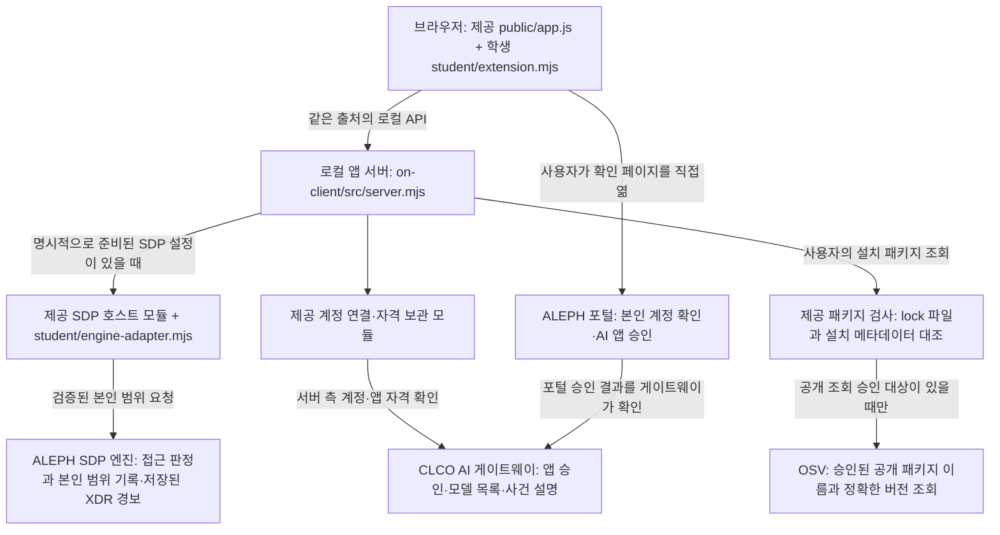

# 케셰브 학생용 실행 설명서와 시스템 구성도

이 문서는 학생이 작성한 21단계 문서입니다. 제공 문서와 학생 코드는 덮어쓰지 않았습니다. 코드 대조 기준은 `a71210cb3b002b9f9060f3c895f2f067ab3afd14`(20단계 저장점), 문서 작성·환경 확인일은 2026-10-28입니다. 21단계 문서를 포함하는 새 커밋 번호는 커밋한 뒤 `git rev-parse HEAD`로 확인합니다. 아직 만들지 않은 커밋이나 공식 통과 결과를 적지 않습니다.

## 1. 목적과 현재 확인 범위

케셰브는 직원이 본인의 로그인·기기·현재 세션, 업무 앱 접근 판정, 본인의 접속·XDR 기록과 참고용 AI 설명을 확인하는 로컬 보안 Agent 앱입니다. 사람 확인이 필요한 조치 상태와 패키지 취약점 조회 상태도 구분해 표시합니다. 로그인 성공, AI 승인, 모델 목록 접근, 사건 설명, 실제 보안 조치 효과는 각각 다른 확인입니다.

현재 계정 연결·AI 앱 승인과 모델 목록 점검은 사용자 화면에서 확인했습니다. 원천 자료·판정 엔진은 미연결이며 실제 사건 설명·집행·OSV 조회는 미실행입니다. 화면의 `연결 없음`은 제공 서버가 전달하는 원천 엔진의 `disconnected` 모드이므로, AI 점검의 `verified`와 함께 나타날 수 있습니다. 미연결·미조회·확인 불가를 안전이나 성공으로 바꾸지 않습니다.

## 2. 필요한 프로그램과 버전

| 항목 | 코드·안내의 기준 | 이 PC에서 확인한 범위 |
| --- | --- | --- |
| 운영체제 | Windows용 PowerShell 실행 도구 | Windows에서 실행 확인. 다른 OS는 미확인 |
| Node.js | `on-client/package.json` 기준 24.19.0, 실제 런처 허용 범위 22~24 | `node --version`: v22.18.0. 이전 단계 로컬 서버 실행과 학생 문법 검사 확인 |
| Windows PowerShell | 실행 명령의 `powershell` | 5.1.26100.9711 버전 출력 확인. 사용자가 제공 실행 도구로 앱 실행을 확인 |
| PowerShell | 문서 작성 시 파일·구조 점검에 사용한 별도 셸 | 7.6.5. 앱 실행 명령은 Windows PowerShell을 호출함 |
| Git | 저장소 상태·커밋·원문 제출에 사용 | 2.40.0.windows.1 버전 출력 확인 |
| 브라우저 | 로컬 HTTP·DOM·키보드 조작 지원 | 사용자가 Chrome 개발자 도구와 로컬 화면을 확인. 정확한 브라우저 버전은 미확인 |

`on-client/package.json`의 외부 dependencies/devDependencies는 없고, 현재 `on-client/package-lock.json`도 없습니다. 이 로컬 앱을 실행하려고 패키지나 lock 파일을 새로 만들 필요는 없습니다. 설치되지 않은 Node.js·Git은 제공 [시작 안내](STUDENT_LAUNCH_GUIDE.md)의 준비 절차를 따릅니다. 이번 21단계에는 프로그램 설치·의존성 설치·버전 변경을 하지 않았습니다.

저장소 루트의 `package.json`·`package-lock.json`은 1~12단계 자료실용이며 Supabase·WebAuthn 등의 의존성이 있습니다. `on-client` 앱의 실행 조건과 혼동하지 않습니다. `npm.cmd run check`는 학생 모듈 문법만 검사하며 실제 연결이나 전체 기능 시험이 아닙니다. `npm.cmd start`는 로컬 서버를 직접 실행하지만, 계정 연결 자동 준비는 아래 제공 PowerShell 도구의 역할입니다.

## 3. 실제 작업 폴더와 파일

현재 PC의 Git 최상위는 `D:\ALEPH_choi-bujang-secret-vault`이고, 앱 실행 위치는 그 아래 `on-client`입니다. 다른 PC에서는 받은 저장소의 실제 위치로 바꿉니다. 이전 C 드라이브 작업 폴더를 실행 위치로 사용하지 않습니다.

```text
D:\ALEPH_choi-bujang-secret-vault\      Git 최상위, 커밋·제출 기준
├─ README.md                          누적 학생 작업 기록과 이 설명서 링크
├─ package.json / package-lock.json   기존 1~12단계 자료실
├─ aleph.config.json                  기존 자료실 설정(step 12)
├─ api/                               기존 Vercel 자료실 서버 함수
├─ src/decider.mjs                     기존 학생 ZTNA 판정 규칙
├─ src/detect.mjs                      기존 가상 사건 탐지
├─ xdr/                               기존 보너스 경보 판정·대응 모듈
└─ on-client/                         13단계 이후 케셰브 앱
   ├─ package.json                    시작 틀 0.2.21, start/demo/check/package-app
   ├─ .env.example                    비밀 없는 제공 설정 견본
   ├─ student/extension.mjs           학생 화면 함수 8개
   ├─ student/engine-adapter.mjs      제공된 본인 범위 원천 연결 어댑터
   ├─ public/index.html / app.js      제공 화면·메뉴·요청·갱신 처리
   ├─ public/vulnerabilities-view.mjs 제공 취약점 응답 검증과 표시
   ├─ src/server.mjs                  제공 로컬 HTTP 서버
   ├─ src/engine/                     제공 SDP 호스트 연결·검증
   ├─ src/connection/                 계정 연결·앱 승인·자격 경계
   ├─ src/ai/                         AI 연결·설명 응답 검증
   ├─ src/actions/                    제공 조치 준비·결과 처리
   ├─ src/vulnerabilities/            lock/설치 메타데이터 대조·OSV 조회
   ├─ tools/start-alekov.ps1          제공 Windows 실행 도구
   └─ docs/STUDENT_RUNBOOK.md         이 학생 설명서
```

이름에 `alekov`가 있는 제공 실행 파일은 그대로 사용합니다. 케셰브라는 표시 이름이 파일명을 자동으로 바꾸지는 않습니다. 기존 Vercel 자료실과 이 로컬 앱은 같은 Git 저장소에 보존돼 있으나 자동 통합되지 않습니다. `aleph.config.json`을 21로 바꾸거나 루트의 `npm run bundle`을 21단계의 실행·제출 명령으로 사용하지 않습니다.

## 4. PowerShell을 열고 실행하기

파일 탐색기에서 `D:\ALEPH_choi-bujang-secret-vault\on-client`를 연 뒤 주소 표시줄에 `powershell`을 입력하고 Enter를 누릅니다. 다른 위치에서 연 창이라면 다음 명령으로 이동합니다.

```powershell
Set-Location -LiteralPath 'D:\ALEPH_choi-bujang-secret-vault\on-client'
node --version
npm.cmd run check
powershell -NoProfile -ExecutionPolicy Bypass -File .\tools\start-alekov.ps1
```

`npm.cmd run check`가 끝나면 학생 모듈 문법 오류가 없는지 확인합니다. 직접 `node --check .\student\extension.mjs`로 실행하면 오류가 없을 때 출력 없이 끝납니다. 이 결과는 인증·인가나 AI 호출 성공을 뜻하지 않습니다.

정상 시작 신호는 다음 문구와 로컬 첫 화면 응답입니다.

```text
케셰브가 켜졌습니다. 브라우저에서 http://127.0.0.1:5189/ 을 여세요.
서버가 응답한 것만 확인했습니다. AI 연결 상태는 화면에서 따로 확인해 주세요.
```

브라우저에서 [케셰브 로컬 앱](http://127.0.0.1:5189/)을 엽니다. `127.0.0.1`은 지금 실행한 PC이고 다른 사람의 PC 주소가 아닙니다. 세 메뉴는 **보호 현황·업무 앱·보안 기록**입니다. 학생 구현 영역은 제공 화면과 구분되어 `student/extension.mjs · 함수명`으로 표시됩니다.

최신 실행 도구는 기본 실행에서 계정 연결용 개인 설정을 프로젝트 밖 Windows 사용자 폴더에 준비하고, 기존 설정이 있으면 검증하여 재사용합니다. 자동 준비는 계정 로그인·AI 앱 승인·엔진 연결을 대신하지 않습니다. `.env.example`은 견본이며 실행 도구가 이를 자동으로 읽어 운영 연결을 구성하는 것은 아닙니다. 실제 토큰·키·인증서·개인키를 이 파일이나 Git에 넣지 않습니다. 계정 연결 자격은 제공 호스트의 프로젝트 밖 개인 저장소에서 처리합니다.

24.19.0과 다른 허용 버전에 대한 참고 문구나 Node.js의 SQLite ExperimentalWarning만으로 실패라고 판단하지 않습니다. 실제 오류·종료 코드·HTTP 응답을 구분합니다. 이 PC의 v22.18.0에서 과거 실행을 확인했으며, 모든 Node 버전과 환경을 시험한 것은 아닙니다.

## 5. 종료·재실행·새 코드 읽기

| 상황 | 순서 | 확인할 결과 |
| --- | --- | --- |
| 종료 | 앱을 실행한 PowerShell 창에서 Ctrl+C | 21단계에서 사용자가 기존 앱 중지를 보고한 뒤 새 창에서 같은 실행 명령으로 재실행함. 이번 종료 직후 HTTP 실패의 별도 실측은 미실행 |
| 재실행 | 같은 `on-client` 폴더에서 위 `start-alekov.ps1` 명령 재실행 | 첫 화면 응답 확인 뒤 앱의 **다시 불러오기**를 직접 누름. 오류가 새 결과로 교체되는지 확인 |
| 학생 코드 저장 뒤 확인 | 서버가 실행 중인 브라우저에서 Ctrl+F5 | 최신 `student/extension.mjs`를 읽음. 서버를 중지한 상태의 오류 검사는 브라우저 새로고침 대신 앱의 **다시 불러오기** 사용 |
| 포트 사용 중 | 현재 앱의 실행 창을 확인. 별도 실행이 필요하면 아래 다른 포트 명령 사용 | 다른 프로그램을 일괄 종료하지 않음. 브라우저도 실제 포트로 접속 |

선택적인 별도 포트 실행은 다음과 같습니다. 계정 연결 승인 여부는 각 실행 상태에서 다시 확인합니다.

```powershell
powershell -NoProfile -ExecutionPolicy Bypass -File .\tools\start-alekov.ps1 -Port 5190
```

주소는 [다른 포트의 로컬 앱](http://127.0.0.1:5190/)입니다. 이 옵션은 코드로 확인했고, 이번 문서 작성 중 별도 포트 실행은 하지 않았습니다.

이전 단계에서 예제 화면을 확인한 명령은 아래와 같습니다. 예제 사용자와 사건은 운영 계정·원천 엔진·실제 AI 결과의 증거가 아닙니다.

```powershell
powershell -NoProfile -ExecutionPolicy Bypass -File .\tools\start-alekov.ps1 -Demo -Port 5190
```

`-Demo`는 계정 연결 설정을 자동 준비하지 않습니다. 기본 실행으로 돌아가려면 예제 서버를 해당 창에서 중지하고 4장의 옵션 없는 명령으로 실행합니다. 서버 데이터·계정·Git 기록·파일을 지우지 않습니다. 창 없는 실행(`-Background`)은 이번 학생 재현 절차에 사용하지 않습니다.

## 6. 시스템 구성도와 출처



이 구성도는 현재 파일의 역할과 조건부 연결 경로를 설명합니다. 원천 엔진과 OSV의 실제 연결 성공을 뜻하지 않습니다. 학생 렌더러는 제공 코드가 넘긴 값으로 DOM을 만들고, 독자적인 자료 조회·AI 호출·조치 집행 요청을 보내지 않습니다. 제공 `public/app.js`가 사용자 버튼 조작에 따라 로컬 API를 요청하고, 응답 검증·취소·세대 비교 후 학생 함수에 새 값을 전달합니다.

| 경로·주소 | 역할·출처 | 현재 확인 |
| --- | --- | --- |
| `on-client/public/app.js` → `on-client/src/server.mjs` | 제공 코드의 같은 출처 로컬 API. 토큰을 학생 렌더러에 넘기지 않음 | 로컬 화면과 오류 표시 확인 |
| `on-client/src/engine/sdp-host.mjs` → ALEPH SDP 엔진 | 제공 엔진의 본인 범위 접속·기록 계약. 실제 주소·개인 자격은 프로젝트 밖의 담당자 제공 설정 | 원천 엔진 미연결. 임의 relay 주소·인증서를 만들지 않음 |
| `on-client/src/connection/`·`on-client/src/ai/` → [CLCO 게이트웨이](https://ai-classroom-gateway-production.up.railway.app) | 제공 모듈이 처리하는 계정·앱 승인·서버 측 AI 연결 | 계정·앱 승인, 모델 목록 `verified`·1개를 사용자 화면에서 확인 |
| 브라우저 → [ALEPH 포털](https://aleph-omega.vercel.app) | 사용자가 본인 계정 확인과 AI 앱 승인을 수행 | 사용자 보고로 확인. 일회성 확인 URL·번호는 기록하지 않음 |
| `on-client/src/vulnerabilities/project-scan.mjs`·`osv.mjs` → [OSV 공개 조회](https://api.osv.dev/v1/querybatch) | 제공 검사기가 승인된 공개 패키지와 설치 버전을 대조하여 조회 | 프로젝트 미설정이므로 실제 OSV 조회는 미실행 |
| 루트 `src/decider.mjs`·`src/detect.mjs`·`xdr/` | 이전 단계의 학생 판정·탐지·가상 경보 모듈 | Git에 보존. 로컬 앱 시작만으로 이 모듈이나 기존 Vercel 자료실이 자동 연결되지는 않음 |

접근 제어 엔진의 출처는 **ALEPH SDP 엔진**입니다. 학생의 판정 규칙·XDR 가상 경보 작업과 13~20단계 학생 UI는 그 제공 엔진 전체를 새로 구현한 것으로 표시하지 않습니다. Workbench 수업용 AI는 개발 지원, 앱 내부 AI는 사건 해석, ALEPH 공식 과제 AI는 제출 원문 검토 역할입니다. 이 세 역할을 구분합니다.

## 7. 학생 구현 함수와 입력 계약

여덟 함수는 모두 `on-client/student/extension.mjs`의 `createStudentView`가 반환합니다. 제공 화면이 상태·자료를 전달하고, 학생 함수는 새 DOM을 반환합니다. `idle/loading/ok/error` 등의 조회 상태와 자료 안의 업무 판정·실행 상태는 별개입니다.

| 단계·학생 함수 | 받는 값 | 구현한 표시와 한계 |
| --- | --- | --- |
| 13 `renderIdentity` | `{me,devices,sessions}` 각각 `{status,mode,data?,error?}` | 사용자·기기·세션의 ID/이름, 기기·세션 상태의 한국어와 원래 코드, 오류 시 이전 정보 제거 |
| 14 `renderDecision` | `{status,mode,data?,error?,appId}`, data는 `{appId,decision,reason,checkedAt}` | allow·deny·challenge·unknown와 요청 실패 구분. 허용은 실제 앱 접속 성공을 보장하지 않음 |
| 15 `renderEvents` | `{status,mode,data?,error?}`, data는 본인 기록 배열 | 최신순, 종류·앱·접속 상태 필터, 근거·규칙·세 상태 상세. 서버 조회 범위는 최근 40건이며 학생 함수에 전체 메타데이터는 전달되지 않음 |
| 16 `renderStatus` | `{devices,sessions,notifications,diagnostics,mode}` | 빈 목록·실패·수동 재조회 안내, 알림별 resource/code/message, 안전한 진단 6항목과 클릭 시 복사. 미지원 조치는 `renderEvents` 상세의 비활성 안내 |
| 17 `renderAiConnection` | `{status,mode,data?,error?,checkedAt,explanationAccepted}` | test·verified, 모델 수·시각, 안전한 오류 원인과 직접 재점검 안내. 모델 목록을 사건 설명 성공으로 계산하지 않음 |
| 18 `renderExplanation` | `{event,explanation,checkedAt}` | 현재 사건의 근거 ID와 문장·규칙·unknown·제안 미실행을 대조. 없는 근거·실행됐다는 응답에 성공 표식 없음 |
| 19 `renderAction` | `{status,event,actionId,target,receipt,observation,message,confirmationExpiresAt?,error?}` | 사람 확인 전 준비·미실행, 전송·ACK·효과 관측 구분. succeeded와 effectApplied:true인 경우만 효과 확인. 버튼·티켓·집행 요청을 추가하지 않음 |
| 20 `renderVulnerabilities` | `{status,mode,data?,error?}`, data는 전체 상태·lock 메타데이터·packages | 정확한 설치 버전·출처·시각·취약점 ID/modified, 미조회와 부분 실패 구분, 받은 취약점 보존. 빈 결과는 안전 보장이 아님 |

`public/app.js`, `src/**`, `tools/**`, `vendor/**`, 메뉴·인증·서버 요청 코드는 시작 틀 제공 부분입니다. 제공 `student/engine-adapter.mjs`도 이번 13~21단계에서 학생이 새로 작성한 연결 성과로 계산하지 않습니다. 0.2.21의 PC 상태·꾸밈·패키지 도구가 포함돼 있다는 사실은 학생 구현이나 실제 사용 확인을 뜻하지 않습니다.

## 8. 화면 확인 기록과 미확인 항목

| 기능 | 실제 화면에서 확인한 내용(사용자 보고) | 모의 점검·코드 대조 | 현재 미확인·미실행 |
| --- | --- | --- | --- |
| 세 메뉴·계정 표시 | 마우스·키보드 메뉴 이동, 예제 사용자·기기·세션, 서버 중지 오류와 이전 정보 제거 | 상태·모드 및 raw 코드 병기 | 실제 SDP 신원·등록 기기·세션 연결 |
| 업무 앱 판정 | 예제 library allow, repository deny, approval challenge, 이유·시각, 키보드 요청과 서버 중지 실패 | unknown 정규화, 실패 분리, 새 DOM | 실제 원천 앱의 허용·거부와 실제 앱 접속 |
| 보안 기록 | 예제 한 건의 목록·상세·다시 불러오기 뒤 상세 초기화, 실제 미연결 오류 | 다중 기록·필터·순서·empty/error 구분·미지원 조치 | 실제 본인 접속/XDR 기록 조회 |
| 진단·알림 | 학생 복사 6항목, 오류·복구, 별도 도움정보 조회 | 안전한 필드 투영, 비활성 안내, 자동 요청 없음 | 실제 운영 진단의 전체 환경 |
| AI 연결 | 시간 동기화 안내 후 계정 확인·별도 앱 승인, verified와 모델 1개, 2026-10-28T02:43:16.400Z. 제공·학생 시각 일치 | 오류별 안내·초기화·취소·늦은 응답 억제 | 실제 모델 추론·유료 호출·사건 설명 |
| AI 사건 설명 | 기록 미선택과 원천 미연결 안내 | 사건·근거·규칙 대조, unknown 표시, 제안 미실행 | 실제 두 사건 설명·현재 근거 연결 |
| 보안 조치 | 아직 미실행(idle), 사람 확인·취소 의미 안내 | 11상태, strict effectApplied:true, 새 입력 교체, 제공 코드의 중복·늦은 응답 경계 | 실제 학생 계정 집행·원천 효과·결과 재조회는 기다림(UNV) |
| 패키지 조회 | PROJECT_NOT_CONFIGURED/not_configured, 2026-10-28T03:48:22.510Z 일치, 미조회 안내 | 정확한 버전/범위 구분, 일부 취약점 보존, 취소·직접 재조회·늦은 응답 경계 | 실제 OSV 조회·설치 버전/lock 대조 |
| 21단계 문서 실행 | 사용자가 기존 앱 중지 후 새 PowerShell 창에서 문서 명령으로 재실행. 계정 연결 준비·Node v22.18.0 참고·SQLite 경고 뒤 서버 응답과 세 메뉴 표시 확인을 보고함 | 실제 경로·명령·버튼·버전·입력 계약, 상대 링크와 변경 범위를 대조하고 npm.cmd run check 통과 | 이번 종료 직후 HTTP 실패 실측, 재실행 후 실제 엔진·AI·OSV 연결 재확인은 미실행 |

앞 단계에서 실시한 모의 검사는 일시적 Node.js 입력으로 수행했고 학생 제출 파일에 시험용 서버나 가상 성공 응답을 넣지 않았습니다. 제공 문서에 기재된 운영 측 검수는 이 PC의 실제 학생 연결 결과로 옮겨 쓰지 않습니다. 각 단계의 세부 기록은 저장소 루트 README에 남아 있습니다.

## 9. 오류별 확인·복구 순서

| 오류·상태 | 먼저 확인할 것 | 직접 할 다음 동작과 복구 범위 |
| --- | --- | --- |
| Node.js 없음·허용 범위 밖 | `node --version`, 실행 위치 | 제공 시작 안내로 필요한 프로그램·버전 준비 후 새 창. 이 문서에서 자동 설치하지 않음 |
| 앱 폴더 아님·파일 없음 | `on-client/package.json`, `student/extension.mjs`, `tools/start-alekov.ps1` 존재 | 올바른 앱 폴더에서 실행. 기존 파일 위에 시작 틀 전체를 덮어쓰지 않음 |
| 포트 사용 중 | 본인이 이미 실행한 앱 창과 주소 | 기존 앱을 사용하거나 별도 포트로 실행. 모든 node 프로세스를 종료하지 않음 |
| 로컬 서버 연결 실패·NETWORK_ERROR | 실행 창, 브라우저 주소·포트 | 해당 앱 재실행 후 앱의 **다시 불러오기**를 직접 누름. 진단은 **도움정보 불러오기**를 따로 눌러 확인 |
| NATIVE_HOST_DISABLED | 최신 `tools/start-alekov.ps1`로 켰는지, `-Demo`·`-NoNativeHost` 사용 여부 | 본인 앱을 중지하고 기본 실행. 최신 도구가 준비 오류를 내면 첫 오류만 확인. 임의 개인 설정·자격 생성 안 함 |
| NATIVE_HOST_CONTEXT_CHANGED | 현재 로그인·기한·같은 계정 여부, PC 시간과 동기화 상태 | **현재 로그인 확인**으로 상태 확인. 계속 실패하면 **계정 연결 취소**의 서버 확인 후 새로 시작. 이 PC에서는 약 23~24초 시간 차이 관측 뒤 동기화 안내 후 성공을 보고했으며 단일 원인은 확정하지 않음 |
| AI_REQUEST_UNVERIFIED·권한 준비 중 | 계정 확인과 AI 앱 승인 각각의 결과 | 연결·점검 결과를 미확인으로 유지. **현재 API 연결 점검**을 직접 사용하고 안전한 오류 코드 확인. 키·모델을 복사·대체하지 않음 |
| ENGINE_NOT_CONNECTED | 자료·판정 원천 연결 여부 | 기본 어댑터는 disconnected임을 확인. 담당자가 준비한 SDP 설정이 없으면 오류를 미연결로 남김. 임의 연결을 만들지 않음 |
| AI 설명 실패·근거 불일치 | 현재 선택 사건과 안전한 오류 코드 | 원 기록은 유지. 실제 근거가 준비된 환경에서 현재 사건을 다시 선택. 유료 요청을 확인용으로 반복하지 않음 |
| ACTION_UNSUPPORTED·unknown·expired | 지원 조치·현재 사건/대상·확인 기한·관측 여부 | 미지원은 실행 안 함. unknown은 효과 없음으로 단정하거나 재집행하지 않고 **원천 결과만 재조회**. expired는 새 준비와 별도 사람 확인이 필요하나 현재 환경에서 실제 집행 시험하지 않음 |
| PROJECT_NOT_CONFIGURED / not_configured | 조회 대상 프로젝트 설정 여부 | 설정 필요·미조회로 표시. 경로·허용 목록은 담당자가 준비하며 학생이 임의로 바꾸지 않음 |
| NO_APPROVED_PACKAGES / not_checked | 승인된 공개 조회 대상 유무 | 미조회로 기록. 비공개 패키지를 밖으로 보내거나 승인 목록을 늘리지 않음 |
| LOCKFILE_UNVERIFIABLE / unverifiable | 실제 대상의 lock 파일·설치 메타데이터 확인 가능 여부 | 확인 불가로 남기고 설정·파일 상태 확인. 취약점 없음으로 표시 안 함 |
| partial·패키지 unverifiable | 이미 받은 취약점 ID와 수정 시각 | 받은 항목은 유지, 전체 조회는 확인 불가로 구분. 패키지 버전을 임의로 낮추지 않음 |
| 시간 초과·취소 | 현재 요청 상태와 오류 문구 | 자동 재요청 안 함. 사용자가 조회 버튼을 직접 눌렀을 때만 새 요청. 늦은 이전 결과가 표시되는지 확인 |

도움 요청용 학생 **도움정보 복사**는 `requestId`, `component`, `version`, `checkedAt`, `engine.mode`, `engine.code`만 사용합니다. 복사 내용을 직접 읽고 비밀값이 없는지 확인합니다. 제공 화면의 별도 복사 버튼과 학생 버튼은 구분합니다. 비밀번호·토큰·인증서·개인키·원문 설정·일회성 승인 번호나 URL을 문서·대화·커밋에 넣지 않습니다. 전체 PC 설정이나 인증정보를 초기화하지 않습니다.

## 10. 커밋과 21·22단계 원문 제출

이 절차는 사용자가 제공한 현재 21단계 안내를 기준으로 씁니다. 현재 Workbench의 **포털 제출 준비**는 13~20단계용이며, 21·22단계에서는 해당 과제 화면에 저장소 주소와 40자리 커밋을 직접 입력합니다. 서버 AI는 README·학생 문서·구성도·코드·설정 견본을 함께 읽으며, 실행·시연 성공을 인증하지 않습니다.

Git 최상위 폴더에서 변경 목록을 먼저 확인합니다. 아래 명령은 상태 조회이며 커밋·업로드·제출을 하지 않습니다.

```powershell
Set-Location -LiteralPath 'D:\ALEPH_choi-bujang-secret-vault'
git status --short
git diff --name-only
git diff --cached --name-only
git remote get-url origin
git rev-parse HEAD
```

확인한 origin은 [본인 GitHub 저장소](https://github.com/Miko351/choi-bujang-secret-vault)입니다. 학생 문서와 현재 누적 코드를 같은 커밋 상태로 저장하고, 실제 생성한 40자리 커밋을 사용합니다. 이미 stage된 다른 변경이 있으면 보존하고 내용을 확인합니다. 저장만 한 파일은 제출 원문에 포함되지 않습니다. 이 문서는 21단계 커밋·푸시·제출을 실행했다고 주장하지 않습니다.

비공개 저장소라면 공개로 바꿀 필요가 없습니다. 해당 단계의 **비공개 저장소 원문 준비 방법**에서 받은 `student-source-cli.mjs` 도구 ZIP은 프로젝트 밖에 풀고, 출력 JSON을 둘 새 폴더도 프로젝트 밖에 만듭니다. Git 최상위에서 과제 화면의 실제 명령·도구 경로·출력 경로와 `--commit`의 실제 해시를 대조한 뒤 실행합니다. 구체 명령은 아직 제공받지 않았으므로 이 문서에서 만들지 않습니다. 이 도구의 실행·JSON 생성·업로드는 이번 단계에 미실행입니다.

도구는 커밋된 원문만 묶고 학생 코드를 실행하거나 업로드하지 않습니다. 생성한 JSON을 같은 단계의 **비공개 저장소 원문 묶음**에 선택하고 저장소·커밋·단계를 직접 대조합니다. 원문 전달만 실패하면 기존 접수를 유지하고 **원문만 다시 보내기**를 사용합니다. 원문 전달 완료와 공식 AI 통과는 별도입니다.

## 11. 첫 직접 재현 확인

새 PowerShell 창에서 4장의 실행 절차를 따라 첫 화면 주소가 안내되는지 확인합니다. 앱이 이미 실행 중이면 먼저 그 앱의 실행 창을 확인하고, 현재 창을 중지할지 또는 별도 포트를 쓸지 구분합니다. 기존 파일·설정·Git 기록은 그대로 둡니다. 2026-10-28 사용자는 기존 앱을 중지한 뒤 새 PowerShell 창에서 위 명령을 실행했습니다. 계정 연결 준비 완료, Node.js v22.18.0 참고, SQLite ExperimentalWarning, http://127.0.0.1:5189 서버 응답과 정상 시작 문구를 보고했고, 브라우저에서 보호 현황·업무 앱·보안 기록 세 메뉴가 잘 표시된다고 확인했습니다. 이는 문서에 따른 중지 보고·새 창 재실행·첫 화면 확인이며, 이번 실행의 실제 원천 엔진·AI 설명·집행·OSV 조회까지 확인한 것은 아닙니다.

관련 제공 문서: [시작·실행 안내](STUDENT_LAUNCH_GUIDE.md), [AI 연결 안내](AI_SETUP_GUIDE.md), [오류 안내](CONNECTION_TROUBLESHOOT.md), [입력 계약](IMPLEMENTATION_CONTRACT.md), [제공 SDP 호스트 계약](SDP_HOST_CONNECTION.md). 해당 문서의 운영 측 시험 기록과 현재 학생의 실제 확인을 구분합니다.
